# FgcSplitterBetterUi

A Windows desktop front end for [FGC Keyboard Splitter](https://github.com/Ronick80/FgcKeyboardSplitter). The engine
(`FgcCore.dll`, the keyboard capture and virtual Xbox controllers) lives in that repository; this one only holds the
user interface and does not contain any engine code.

It turns each keyboard you plug in into its own virtual Xbox controller, so two players can share one PC with two
keyboards, or one player can use a keyboard as a fight stick in any game that supports controllers.

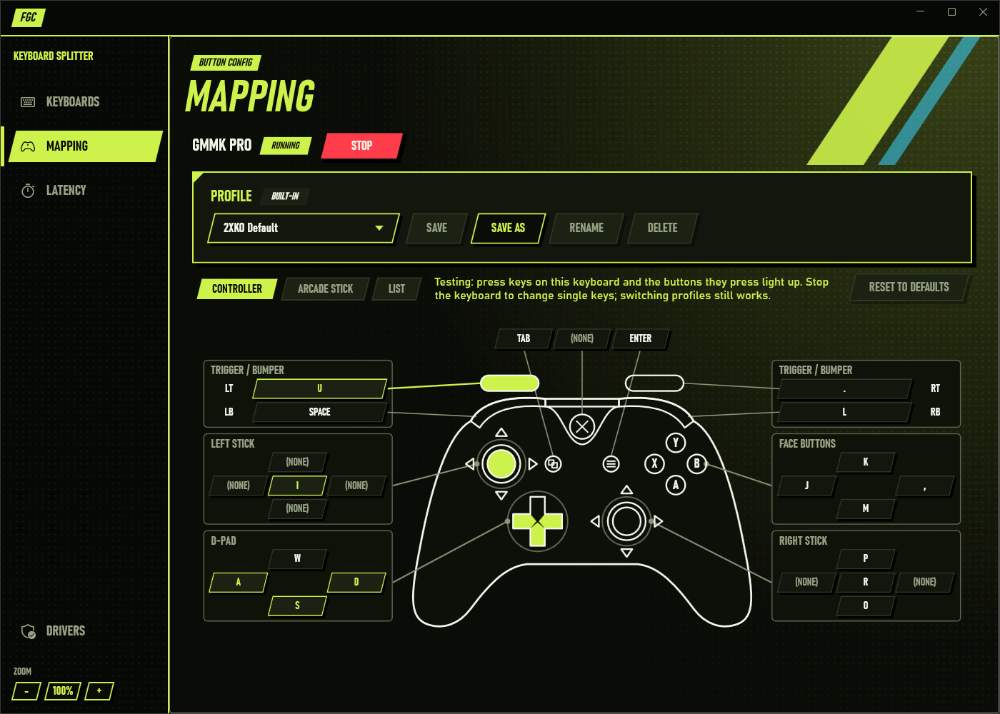

## Contents

- [Using the app](#using-the-app)
  - [Getting started](#getting-started)
  - [1. Install the drivers](#1-install-the-drivers)
  - [2. Add your keyboard](#2-add-your-keyboard)
  - [3. Map your buttons](#3-map-your-buttons)
  - [Profiles](#profiles)
  - [4. Start your keyboard](#4-start-your-keyboard)
  - [Test your buttons](#test-your-buttons)
  - [Latency](#latency)
  - [Good to know](#good-to-know)
- [Development](#development)
- [Ideas for later](#ideas-for-later)

## Using the app

The usual flow is: **add your keyboard** by pressing a key on it, **map** its keys to controller buttons, then
**start** it. From then on the keyboard is a controller: games see an Xbox controller, and its keys no longer type
anywhere else until you stop it.

### Getting started

You need Windows 10 or 11 (64-bit).

1. Download `FgcSplitterBetterUi-<version>-win-x64.zip` from the
   [releases page](https://github.com/Ronick80/FgcSplitterBetterUi/releases) and extract it to a folder of its own.
2. Keep the files together: `FgcKeyboardSplitter.exe` needs `FgcCore.dll`, `FgcDriverSetup.exe` and the `drivers`
   folder next to it. Nothing else needs installing (no .NET runtime).
3. Run `FgcKeyboardSplitter.exe`. The first time, install the drivers (next step).

### 1. Install the drivers

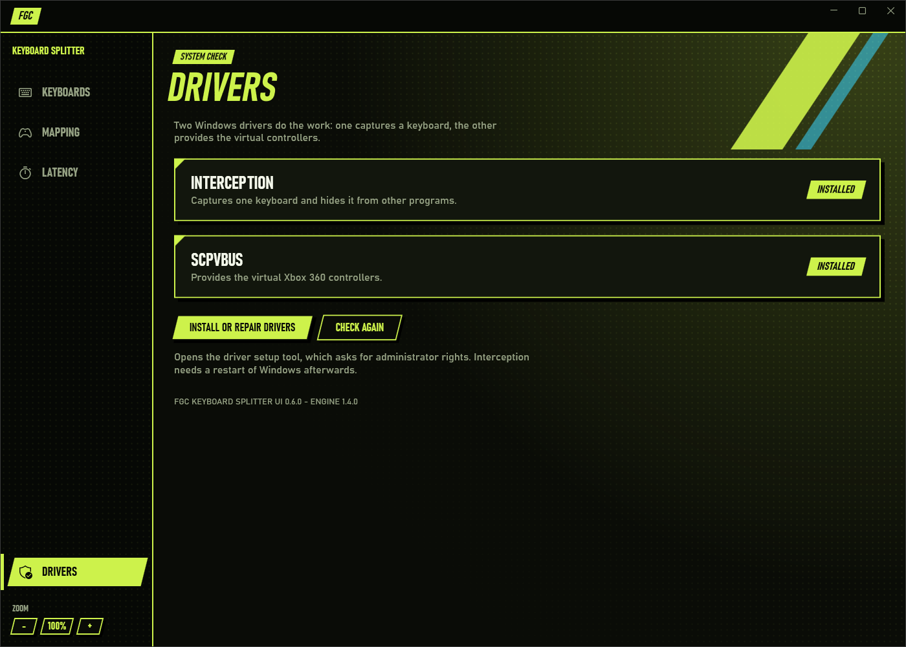

The app relies on two Windows drivers:

- **Interception** captures one specific keyboard and hides its keys from other programs.
- **ScpVBus** provides the virtual Xbox 360 controllers.

Open **Drivers** in the sidebar and click **Install or repair drivers**. This starts the driver setup tool, which asks
for administrator rights and installs whatever is missing. Interception only becomes active after a restart of
Windows, so its status shows **Restart required** until then. Click **Check again** after installing to refresh the
status. Both drivers need to show **Installed** before a keyboard can start; until then the Keyboards page shows a
**Driver missing** banner with a shortcut to this page.

The line at the bottom of the page shows the app and engine versions, which is useful when reporting a problem.

### 2. Add your keyboard

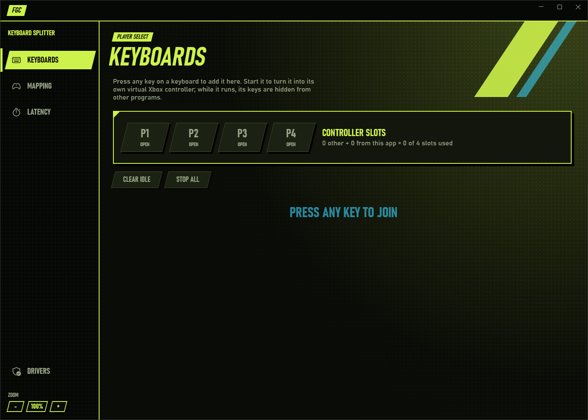

The **Keyboards** page starts empty and says **Press any key to join**. Press any key on the keyboard you want to use
and it appears in the list under its real name, such as "GMMK PRO". Only keyboards you press a key on are listed, so a
gaming mouse with keyboard buttons, or the second half of a keyboard that Windows sees as two devices, does not clutter
the list.

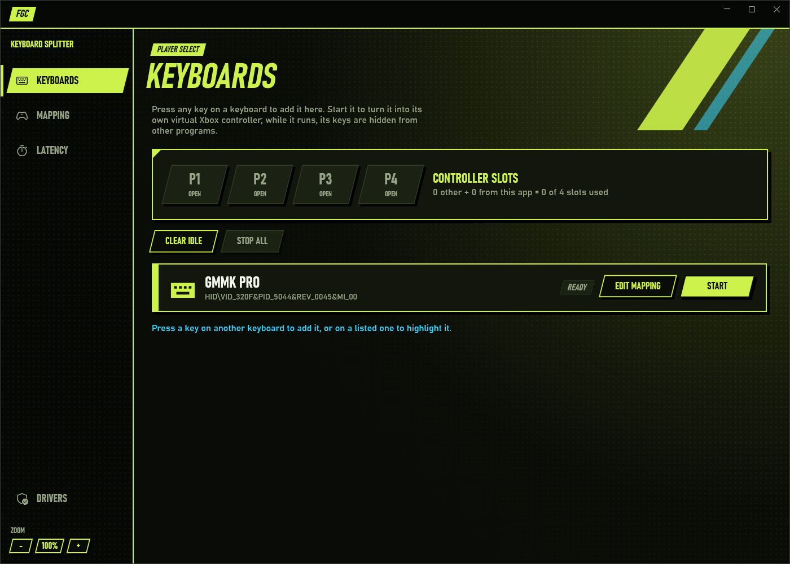

- **Which one is mine?** Press a key on a listed keyboard and it is selected and flashes **< THAT'S YOU**. This also
  works for keyboards that are already running, so players can check which keyboard is theirs at any time.
- **More keyboards:** press a key on each one. Identical keyboards are numbered ("GMMK PRO", "GMMK PRO #2").
- **Clear idle** removes the keyboards that are not running; they come back with their next key press.
- Key presses are only watched for while the Keyboards page is open and the app window is active, so leaving the app
  open on this page does not affect your keyboards while you play.

Click **Edit mapping** on a keyboard to choose which key does what.

### 3. Map your buttons

The **Mapping** page shows the keyboard selected on the Keyboards page. Three views show the same mapping; pick
whichever is easiest to read.

| Controller | Arcade stick | List |
|---|---|---|
| 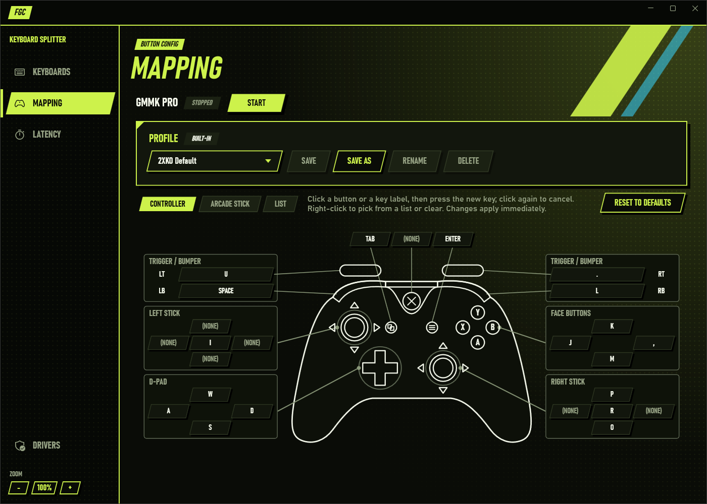 | 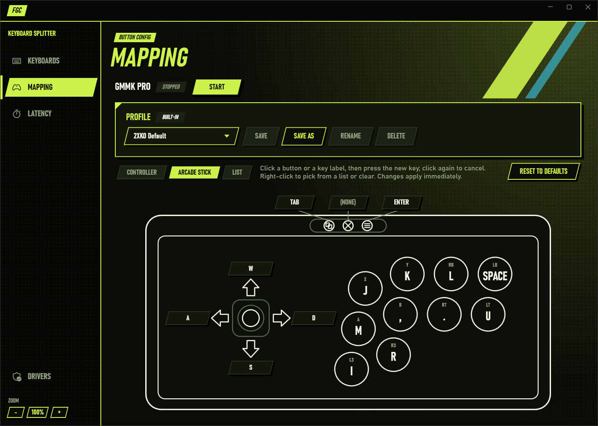 | 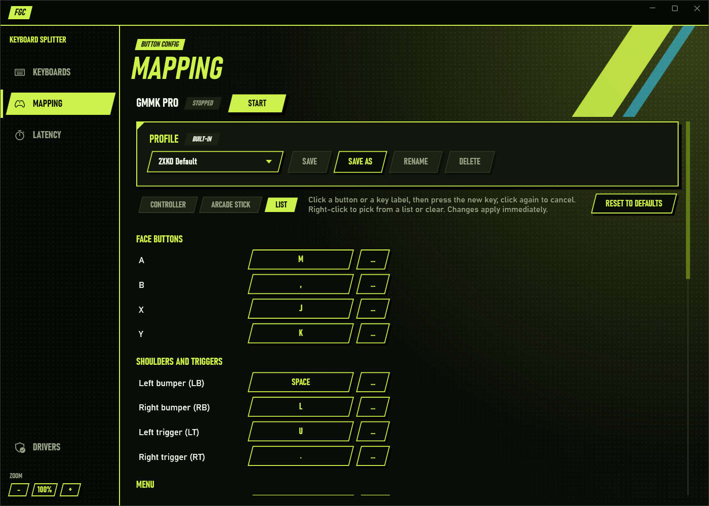 |
| Every Xbox input around a controller drawing, grouped as triggers and bumpers, sticks, D-pad and face buttons. | A fight stick layout: directions on the left, the eight buttons on the right, with the key printed inside each button. The analog sticks are left out. | Every input in a plain list, grouped by kind. Easiest for scanning or at a small window size. |

**Changing a key**

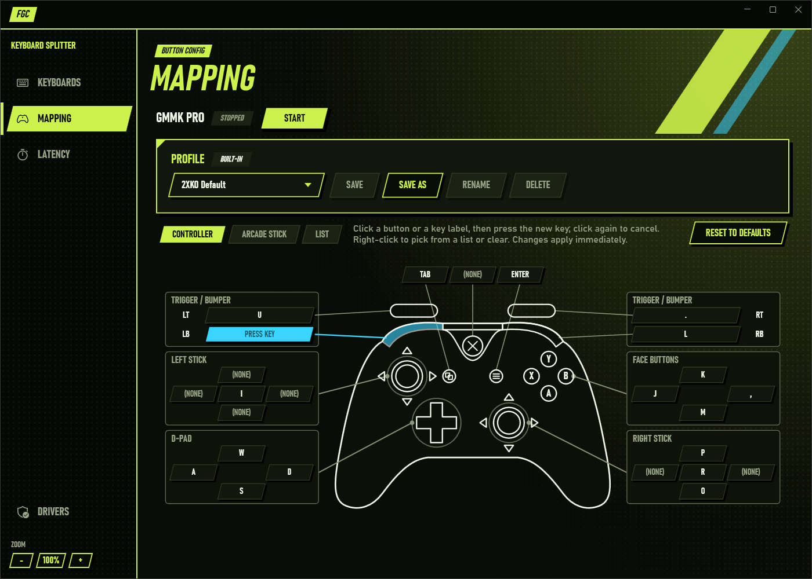

1. Click a button on the drawing or its key label. The label turns blue and says **Press key**.
2. Press the key you want for that input. It is bound immediately.

To cancel instead, click the label again (or switch to another window). Hovering an input lights it up on the drawing,
so you can see which button a label belongs to.

**Other ways to change keys**

- **Right-click** a button or label for **Pick a key from a list** (useful for keys that are awkward to press while
  the app has focus) or **Clear** to unbind the input. In the List view, the **...** button next to each key opens
  the same key list.
- **Reset to defaults** puts back the app's default layout.
- One key can drive several inputs at once. The List view marks such keys with **Shared key**, so an accidental
  double binding is easy to spot.

Changes take effect right away, but they are not saved to a profile until you save (see [Profiles](#profiles)).

### Profiles

A profile is a saved mapping with a name. Each keyboard has its own profiles, and the profile you used last loads
automatically the next time you select or start that keyboard.

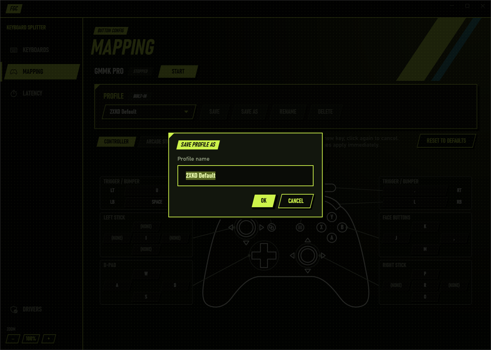

| Action | What it does |
|---|---|
| Profile list | Switch to another profile. This works while the keyboard is running, too. |
| **Save** | Saves your changes into the current profile. An **Unsaved changes** tag appears after any change. |
| **Save as** | Saves the current mapping under a new name (asks before replacing an existing profile). |
| **Rename** / **Delete** | Rename or remove the current profile. Deleting keeps the mapping in use, it is just no longer saved. |

**Built-in profiles** are marked **Built-in** and cannot be changed, renamed or deleted. **2XKO Default** puts 2XKO's
default keyboard layout on the buttons of 2XKO's default arcade stick layout. To adjust it, use **Save as** to make
your own copy first.

Profile names can be up to 63 characters and cannot contain `\ / : * ? " < > |`. Profiles are plain JSON files in
`%APPDATA%\FgcKeyboardSplitter\profiles`, one folder per keyboard, so you can back them up or copy them to another PC.

### 4. Start your keyboard

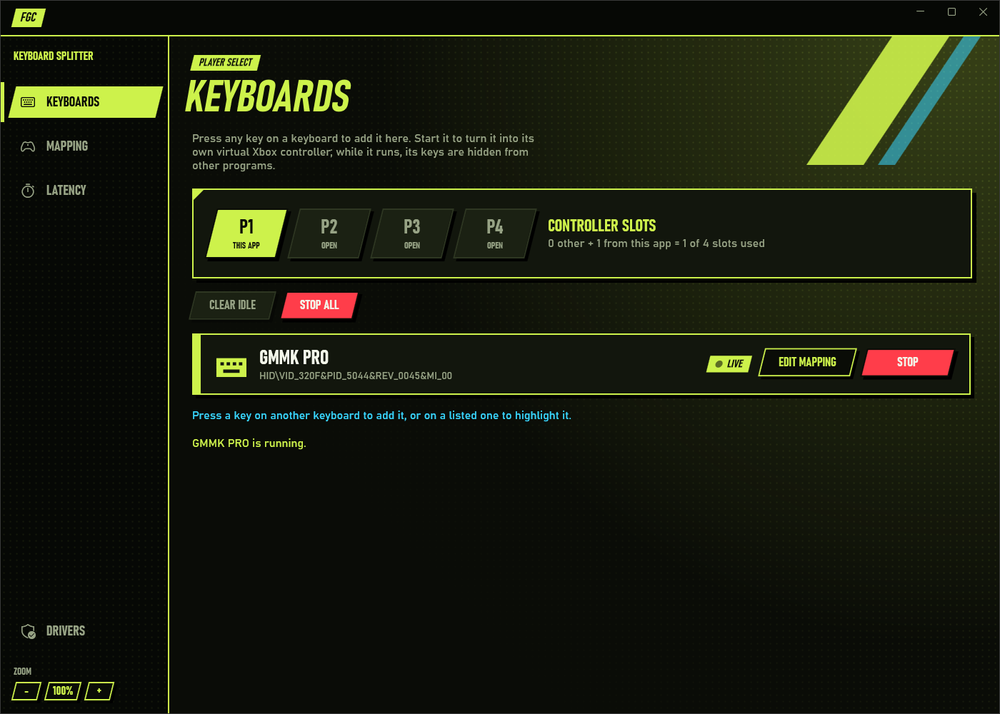

Click **Start** on the Keyboards page (or on the Mapping page). The keyboard becomes a virtual Xbox controller:

- Games see a normal Xbox 360 controller. Its keys go only to that controller and no longer type in other programs.
- The keyboard's card shows **Live**, and the **Controller slots** panel shows which player slot it took.
- **Stop** gives the keyboard back to Windows. **Stop all** stops every running keyboard at once.

Because a running keyboard cannot type, use the mouse (or another keyboard) to click **Stop**. Closing the app also
stops every keyboard and returns it to Windows.

**Controller slots.** Windows supports at most four Xbox controllers in total. The P1 to P4 plates show which slots are
taken by this app (**This app**), which by other controllers that are plugged in (**Other pad**), and which are free.
When all four are taken, **Start** is disabled until one is freed.

### Test your buttons

While a keyboard is running, its Mapping page turns into a button tester: every input the keyboard is holding lights
up on the drawing and its key label, in the Controller and Arcade stick views (see the picture at the top of this page). Single keys cannot
be changed while it runs, because its keys go to the controller, but you can still switch profiles. Stop the keyboard
to change keys again.

### Latency

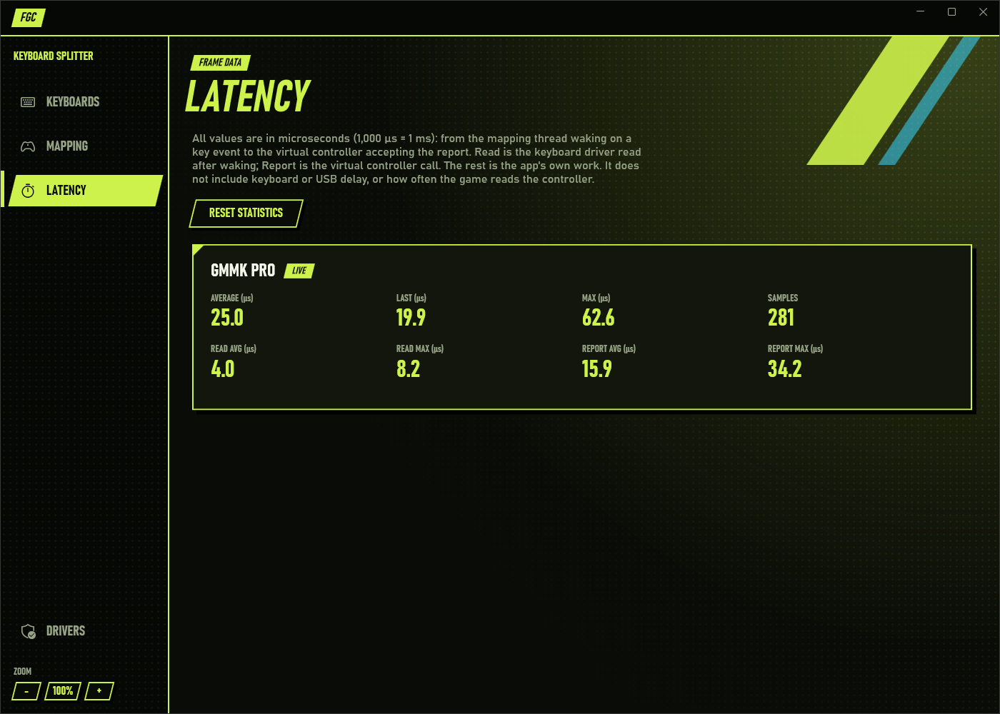

The **Latency** page shows how long the app itself takes to turn a key press into a controller update, for each
running keyboard. All values are in microseconds (1,000 µs = 1 ms). Values in the tens of microseconds, as in the
picture, are a tiny fraction of a single frame (a frame at 60 fps is about 16,700 µs).

| Value | Meaning |
|---|---|
| Average / Last / Max | From the key event arriving to the virtual controller accepting the update. |
| Read avg / Read max | Part of that spent reading the key from the keyboard driver. |
| Report avg / Report max | Part of that spent handing the update to the virtual controller. |
| Samples | How many key events were measured. |

It does not include the keyboard's own scan rate, USB delay, or how often the game reads the controller; those are
outside the app. **Reset statistics** starts the counts over.

### Good to know

- **Opposing directions** (SOCD): pressing left and right together gives neutral; pressing up and down together gives
  up. This applies to the D-pad and both sticks.
- **Unplugging** a running keyboard stops it safely: its controller is released and a **K.O. - Keyboard stopped**
  notice says what happened. Plug it back in and press a key on it to add it again.
- **Another program holding the keyboard**: if a keyboard cannot start because something else has it, the Keyboards
  page says so instead of failing silently.
- **Zoom**: use the **- / + buttons** at the bottom of the sidebar, **Ctrl + plus / minus**, or **Ctrl + mouse wheel**.
  Click the percentage (or press **Ctrl + 0**) to reset to 100%. The zoom is remembered, and the window opens big
  enough for it.
- **Settings** (zoom) and profiles are kept in `%APPDATA%\FgcKeyboardSplitter`.

## Development

### How it fits together

- `core.lock.json` pins one release of the engine repository (version, download URL, SHA-256).
- `scripts/Get-FgcCore.ps1` downloads that release zip, checks the SHA-256 before extracting anything, and unpacks it
  to `core/` (git-ignored). `core/` then holds `FgcCore.dll`, `FgcDriverSetup.exe` and the `drivers` folder.
  Building any project runs the script automatically when `core/` is empty.
- `src/Fgc.Interop` wraps the engine's C API (`core/include/fgc_core.h` in the engine repository). It checks
  `fgc_get_api_version()` and refuses to run against an engine with another API version.
- `src/FgcKeyboardSplitter.Wpf` is the WPF app (`FgcKeyboardSplitter.exe`) built on [WPF-UI](https://wpfui.lepo.co)
  and CommunityToolkit.Mvvm. A build copies `FgcCore.dll`, `FgcDriverSetup.exe` and `drivers\` next to the exe.
- `tests/Fgc.Interop.Tests` tests struct layouts and calls the real `FgcCore.dll`. No test starts a session, so no
  keyboard is captured.
- `tests/FgcKeyboardSplitter.Tests` tests the view models (keyboards, mapping and profiles, latency, drivers) and the
  controller drawing layout against a fake engine, so nothing touches real hardware or your profiles.

### Building

Needs Windows x64 and the .NET 9 SDK.

```powershell
dotnet build
dotnet test
dotnet run --project src\FgcKeyboardSplitter.Wpf
```

To build against your own engine build, point at a folder that contains `FgcCore.dll`:

```powershell
dotnet test -p:FgcCoreDir=C:\coding\FgcKeyboardSplitter\build\bin\Release
```

(or set the `FGC_CORE_DIR` environment variable).

If PowerShell refuses to run the download script, run it as
`powershell -ExecutionPolicy Bypass -File scripts\Get-FgcCore.ps1`.

### Releasing

`version.txt` holds the app version (`MAJOR.MINOR.PATCH`); every project picks it up. To make the package locally:

```powershell
powershell -ExecutionPolicy Bypass -File scripts\Publish.ps1
```

This publishes a self-contained single-file `FgcKeyboardSplitter.exe` (no .NET install needed) and writes
`artifacts\FgcSplitterBetterUi-<version>-win-x64.zip` plus its `.sha256`. The zip also holds `FgcCore.dll`,
`FgcDriverSetup.exe` and the `drivers` folder from the pinned engine release; the script fails if one is missing.

To publish a release: change `version.txt`, commit it, then tag and push (`git tag v0.1.0`, `git push origin v0.1.0`).
The **Release** workflow checks the tag matches `version.txt`, runs the tests that need no hardware, builds the zip
and attaches it to a GitHub release. The **CI** workflow runs the same tests on every push and pull request.

### Updating the engine version

Take the URL of the release zip and the SHA-256 from the release's `.sha256` file, put them in `core.lock.json`, then
run `scripts\Get-FgcCore.ps1`. It replaces `core/` only when the pinned version or checksum changed.

## Ideas for later

Features that would make the app more useful, none of which exist yet. Some need engine changes in
[FGC Keyboard Splitter](https://github.com/Ronick80/FgcKeyboardSplitter) as well.

- **Panic key to stop everything.** A running keyboard cannot type, so a fixed key combination on it that runs
  **Stop all** would help when a game has captured the mouse.
- **Choice of opposing-direction rule (SOCD).** Today left + right gives neutral and up + down gives up. Tournaments
  use different rules (for example last input wins), so a per-profile setting would matter for competitive play.
- **Choosing which keyboard is P1 to P4.** The slot order currently follows the order keyboards are started in, and
  some games care which controller is player 1.
- **Remembering the setup.** Add and start known keyboards with their last profile when the app opens, with optional
  start with Windows and minimize to the system tray.
- **Profile sharing.** An "Open profiles folder" button and import / export, so players can trade layouts.
- **Automatic profile switching per game**, based on which game is running.
- **Shared keys on the drawings.** Show the **Shared key** warning on the Controller and Arcade stick views, not only
  in the List view.
